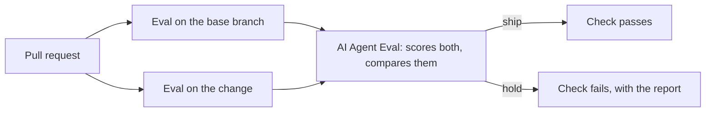

# AI Agent Eval demo

A small support agent for an online shop, and the CI gate that stops a bad change to it from being merged. The agent is evaluated by [AI Agent Eval](https://github.com/VarshithaGudibandi/ai-agent-eval).

## How it works



The agent is a LangGraph graph with two steps: a model step that calls Gemini, and a tool step that looks up orders, checks returns, refunds and escalates. The shop's policy is in its prompt: look the order up and check the return before any refund, refund only what came back, never refund twice, and escalate damage, app and payment problems.

The eval runs the agent on 20 cases, twice each, and the platform grades every run with rules that hold that policy:

| Rule | Fails when |
| --- | --- |
| `refund_after_lookup` | A refund goes out before the order is looked up |
| `refund_after_return_check` | A refund goes out before the return is checked |
| `refund_amount` | The refund is not the expected amount, or there is one where none was due |

The model's replies are recorded once and replayed, so the gate costs nothing and gives the same answer on every run. A change to the prompt or the tools asks the model new questions, so it needs new recordings.

## Run it locally

You need a running platform (see its README) and a member API token from its settings.

```bash
uv sync
export AGENT_EVAL_URL=http://127.0.0.1:8000 AGENT_EVAL_TOKEN=aet_...
uv run evalctl run eval.py
```

To record new replies after changing the agent, with a Gemini key:

```bash
GEMINI_API_KEY=... uv run python record.py
```

## The gate

`eval-gate` runs on every pull request. It starts a fresh platform, runs the eval on the base branch for a baseline, then on the change. `evalctl` exits 1 when the change should be held back, for a new hard rule failure or a real drop in success rate, and the job summary shows why, with the regression report. Make `eval-gate` a required check on `main` and a held change cannot be merged. With a `GEMINI_API_KEY` secret, the report names a likely cause; without one, the gate still blocks.

| Workflow | Runs | Does |
| --- | --- | --- |
| `ci` | Every push | Lint and tests |
| `eval-gate` | Every pull request | The eval on base and change, and the ship or hold call |
| `record` | By hand | Records the model's replies and uploads them for review |

## Files

| Path | What it is |
| --- | --- |
| `support_agent/` | The agent, its tools and the shop's data |
| `cases.jsonl` | The 20 cases |
| `eval.py` | The eval `evalctl` runs, with the policy rules |
| `replay.py` | Records and replays the model's replies |
| `record.py` | Records new replies with the real model |
| `recordings/` | The recorded replies |
| `ci/` | Sets up a fresh platform workspace for the gate |
| `tests/` | Tests for the tools, the graph and the replay |
